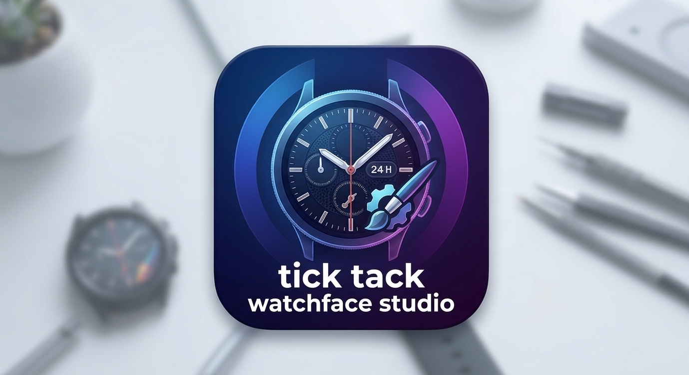
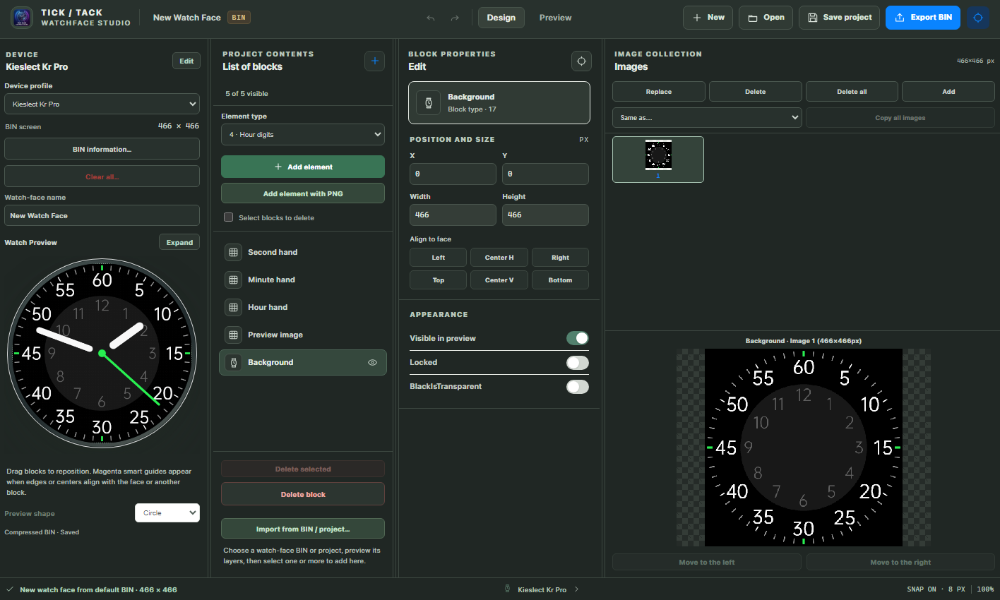

# ⌚ Watchface Studio

<p align="center">
  
</p>

<p align="center">
  **A powerful watch face editor for GloryFit-compatible smartwatches.**
  <br>
  Create, customize, preview, and export watch faces with an intuitive desktop editor.
</p>

<p align="center">
  <a href="https://skillicons.dev">
    
  </a>
</p>

---

## 🖥️ App Preview

<p align="center">
  
</p>

---

## ✨ About the Project

**Watchface Studio** is an open-source watch face editor designed for GloryFit and GloryFit Pro compatible smartwatches.

It allows you to edit, customize, and export `.bin` watch face files while supporting multiple devices and compression formats.

The project includes two editing solutions:

- **C++ Editor:** The original native watch face editing application.
- **React / Electron Editor:** A modern desktop interface with enhanced editing capabilities and project management.

## 🚀 Features

- 🎨 Edit and customize existing watch faces.
- 🖼️ Import and replace PNG images and sprite collections.
- ➕ Add, remove, duplicate, and reposition supported elements.
- 📦 Import and export BIN watch face files.
- 🔄 Support compressed and uncompressed watch face data.
- 👁️ Live watch face preview.
- 📐 Smart alignment guides and positioning controls.
- 🧩 Import elements from other BIN files and projects.
- 💾 Save editable `.wfproj` projects.
- 🎛️ Adjustable editor panels and an expanded editing canvas.
- 🕒 Preview analog hands, date, and time elements.

## ⌚ Supported Devices

| Device | Compatibility |
|---|---|
| Kieslect KR Pro | ✅ Verified |
| Kieslect K11 | Supported |
| MK66 | Supported |
| MK68 | Supported |
| QX11 | Supported |
| P32D | Supported |

*Compatibility depends on the watch face format and device firmware.*

---

## 🖥️ React / Electron Desktop Editor

The desktop editor supports the MK66 / QX11 / P32D BIN format used by the C++ application, including supported compressed watch face data.

It also supports the supplied Da Fit Type C (`0x81` / `0x84`) BIN format through a separate format path.

### Installation

**Requirements**
- Node.js
- npm

Clone the repository and install dependencies:

```bash
git clone https://github.com/mohamed-mouss/Watchface-Studio.git
cd Watchface-Studio
npm install
```

### Run in Development Mode

```bash
npm run dev
```

### Build the Application

```bash
npm run build
```

### Create a Windows Installer

On Windows, run:

```bash
npm run make
```

This builds the renderer and creates a Windows installer under `out/make/`.
The installer is not code-signed, so Windows SmartScreen may show an
"unrecognized app" warning. Avoiding that warning generally requires signing
the app with a trusted code-signing certificate; signing does not guarantee
that SmartScreen warnings disappear immediately.

### Launch Electron

After building the renderer:

```bash
npm start
```

### Run Tests

```bash
npm test
```

---

## 🛠️ Editor Capabilities

### Element Editing

- Reposition existing BIN elements.
- Replace PNG sprites.
- Add supported element types.
- Delete unwanted elements.
- Edit element properties and positions.
- Change image transparency settings.
- Copy image collections between elements.

### Image Management

- Import one or multiple PNG frames.
- Import single images or vertical sprite sheets.
- Replace existing image collections.
- Copy complete image collections using **Same as…** and **Copy all images**.
- Preserve transparency settings for imported elements.

To import multiple frames, first add an empty watch element from Project Contents, select it, then use **Add** in Image Collection.

Use `Ctrl-click` or `Shift-click` to select multiple same-sized PNG files.

### Importing Existing Projects

Use **Import from BIN / project…** to open another watch face and preview its layers.

You can import selected image-backed elements from:

- Another BIN watch face.
- Watchface Studio `.wfproj` projects.
- ClockFaceEdit JSON projects.

Imported elements retain their images, dimensions, positions, and transparency.

### Project Management

The editor supports saving editable `.wfproj` projects.

Duplicate element types can be edited and saved in project files. However, the MK66 BIN format requires unique type IDs, so exporting to MK66 BIN remains disabled until duplicate types are removed.

### Preview & Canvas

- Square BIN dimensions default to a circular preview.
- Other dimensions default to a rounded preview.
- Preview shape can be changed using the **Preview shape** selector.
- Canvas dimensions and aspect ratio are read from the BIN header.
- Preview shape is editor-only and does not modify the BIN dimensions or mask.

Use **Expand** beside the device preview to open a larger editing canvas.

The expanded canvas supports:
- Dragging elements.
- Zooming in and out.
- Fit-to-window mode.
- Escape or Close to return to the editor panels.

### Alignment & Positioning

Magenta smart guides help align elements with:
- Watch face boundaries.
- Other visible elements.
- Horizontal and vertical centers.

Six **Align to face** controls are available:

- Align Left
- Center Horizontally
- Align Right
- Align Top
- Center Vertically
- Align Bottom

### Editor Layout

The four editor panels are:

1. Device
2. Project Contents
3. Block Properties
4. Image Collection

Drag the vertical dividers to resize panels. Focused dividers also support the left and right arrow keys.

Drag elements in Project Contents to change their preview stacking order. This order is saved in `.wfproj` projects.

**Note:** The watch BIN format uses device-defined rendering order and does not store custom layer order.

---

## 🎨 Preview & Rendering Details

The ClockFaceEdit preview follows the original renderer's layer order and element behavior.

- Analog hands rotate around their stored pivots.
- Date and time digits use the current local time.
- Selection bounds and dragging follow transformed hand positions.
- Health, activity, and battery values use sample defaults because live watch data is unavailable in the editor.

### Default Watch Face

On startup and when selecting **New**, the editor loads:

`Default/Default screen.bin`

This is the included 466 × 466 Kieslect-compatible starter watch face.

Selecting a device profile resizes non-BIN canvases. Opened BIN files and the starter watch face retain their embedded dimensions.

---

## 📂 Supported Project Formats

| Format | Support |
|---|---|
| MK66 / QX11 / P32D BIN | Import and export |
| Supported compressed BIN data | Import and export |
| Da Fit Type C BIN (`0x81` / `0x84`) | Import and export |
| Watchface Studio `.wfproj` | Import and export |
| ClockFaceEdit `_WatchFace.json` | Import |

ClockFaceEdit JSON projects require their numbered PNG assets to be located beside the JSON file.

Other JSON project formats are currently not supported.

### BIN Data Handling

- Position-only edits preserve the original BIN payload and compression.
- Editing image data or the item table recompresses item types supported by the source format.
- Other item types remain raw.
- The checksum is recalculated during export.
- Incomplete uncompressed sprite data is recovered with missing pixels represented as transparent black.
- The status bar reports affected items.
- Compressed data that cannot be decoded is reported as an error rather than silently repaired.

**Important:** The built-in sample is a project mockup, not a valid watch face BIN.

---

## 📖 Original C++ Editor Usage

### Menu

| Item | Description |
|---|---|
| Load BIN | Load a watch face BIN file |
| Save BIN | Save the current watch face |
| Quit | Exit the application |
| About | Display application information |

### Toolbar #1

| Item | Description |
|---|---|
| Item Types | Watch face item types |
| Load | Load an item PNG file |
| Save | Save the item PNG file |
| New Item Types | Create new watch face item types |
| Add | Add a watch face item type |
| Del | Delete a watch face item type |
| X Pos | Set horizontal position |
| Y Pos | Set vertical position |
| Shift | Adjust item list vertical shift |

### Toolbar #2

| Item | Description |
|---|---|
| Delta Height | Adjust the height delta for item images |
| Add Height | Add the delta height to item images |
| Default Value | Set the default value for item preview |

### Keyboard Shortcuts

| Key | Action |
|---|---|
| `Esc` | Clear item parameters |
| `F1` | Preview mode |
| `F2` | Details mode |
| `Q` | Previous file in Watchfaces folder |
| `W` | Next file in Watchfaces folder |
| `C` | Create preview image |
| `D` | Toggle debug mode |
| `Numpad -` | Decrease spin button value |
| `Numpad +` | Increase spin button value |
| `Page Down` | Fast decrease |
| `Page Up` | Fast increase |
| Arrow Keys | Move selected item |
| `Shift` + Arrow Keys | Accelerated movement |
| `Shift` + Mouse | Drag selected item |

---

## 📲 Installing a Watch Face on Your Android Device

### Requirements

- Android smartphone.
- Glory Fit application.
- File manager with access to Android application folders.
- A compatible smartwatch.

### Installation Steps

1. Download a watch face using the Glory Fit application.
2. Open your file manager.
3. Navigate to:

   ```text
   Android/data/com.yc.gloryfit/files
   ```

4. Copy the downloaded watch face files to your PC.

   *You may need to grant your file manager permission to access the Glory Fit folder.*

5. Open the BIN file in Watchface Studio.
6. Make your desired modifications.
7. Replace the original watch face file with your edited version.
8. Open Glory Fit and synchronize the watch face with your smartwatch.

**Enjoy your customized watch face!** 🎉

---

## ⚠️ Disclaimer

- This software is provided **AS IS**, without any warranty.
- Use it at your own risk.
- The author is not responsible for damage to your smartwatch or loss of data.
- Always keep a backup of your original watch face files before editing.

---

## 🙏 Credits & Attribution

This project is based on the original work by **[janaboy74](https://github.com/janaboy74)**.

**Original repository:** [wfeditormk66](https://github.com/janaboy74/wfeditormk66)

This version includes significant modifications, new features, enhancements, and bug fixes.

### Improvements

- Added new features and functionality.
- Improved performance and code quality.
- Enhanced the user interface and user experience.
- Fixed bugs and optimized existing functionality.

Special thanks to the original author for making this project possible.

---

## ⭐ Support the Project

If you find Watchface Studio useful:

- ⭐ Star this repository.
- 🐛 Report bugs and issues.
- 💡 Suggest new features.
- 🤝 Contribute improvements.

**Made for smartwatch enthusiasts who love customization.** ❤️

<p align="center">
  <b>Watchface Studio</b>
  <br>
  Customize your watch. Make it yours.
</p>
